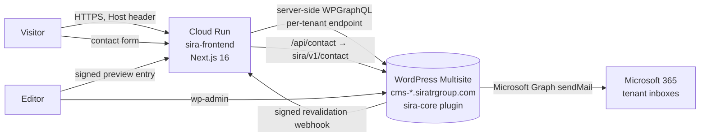

# SIRA Headless — technical handover

**As of:** 2026-10-12 · `main` @ `2cb12ca9` (merge of PR #80) — production
serves exactly this commit. This is a snapshot: HEAD comes from Git, the live
revision comes from Cloud Run.

**Audience:** the engineer or technical owner taking the platform over. The
management summary is [`HANDOVER-MANAGEMENT.md`](HANDOVER-MANAGEMENT.md); the
SIRA Digital site has its own continuation guide,
[`DIGITAL-HANDOVER.md`](DIGITAL-HANDOVER.md). Current state on one page:
[`STATE.md`](STATE.md).

---

## Contents

1. [The system in one paragraph](#1-the-system-in-one-paragraph)
2. [What is live](#2-what-is-live)
3. [Architecture](#3-architecture)
4. [Repository map](#4-repository-map)
5. [Configuration](#5-configuration)
6. [Run, test and build locally](#6-run-test-and-build-locally)
7. [Ship a change](#7-ship-a-change)
8. [Deploy and roll back](#8-deploy-and-roll-back)
9. [Operations runbook](#9-operations-runbook)
10. [Branches, tags and the archive](#10-branches-tags-and-the-archive)
11. [Rules of engagement](#11-rules-of-engagement)
12. [Known issues](#12-known-issues)
13. [Open items](#13-open-items)
14. [Access inventory](#14-access-inventory)
15. [Decision index](#15-decision-index)
16. [History](#16-history)

---

## 1. The system in one paragraph

SIRA runs six brands — Group, Consulting, Healthcare, Lifestyle, Real Estate
and Digital — from **one WordPress Multisite** (content, editorial workflow,
enquiries) and **one Next.js 16 App Router application** (everything a visitor
sees). The app talks to WordPress only over **WPGraphQL**, server-side; the
browser never reaches WordPress. The tenant is chosen by the request's
hostname. Every brand is bilingual (English default, Arabic under `/ar/`). The
app is containerised and runs on **Google Cloud Run**; WordPress stays on its
existing host behind `cms-<tenant>.siratrgroup.com` origins that are never
public-facing.

## 2. What is live

Verified 2026-10-12 against gcloud, DNS and HTTP.

| Brand | Public host | WordPress origin (blog) | Public host served by |
|---|---|---|---|
| Group | `siratrgroup.com` (`www` → 308) | `cms-group.siratrgroup.com` (1) | Cloud Run ✅ |
| Consulting | `consulting.siratrgroup.com` | `cms-consulting.siratrgroup.com` | Cloud Run ✅ |
| Healthcare | `healthcare.siratrgroup.com` | `cms-healthcare.siratrgroup.com` | Cloud Run ✅ |
| Lifestyle | `lifestyle.siratrgroup.com` | `cms-lifestyle.siratrgroup.com` | Cloud Run ✅ |
| Real Estate | `realestate.siratrgroup.com` | `cms-realestate.siratrgroup.com` | Cloud Run ✅ |
| Digital | `digital.siratrgroup.com` (planned: `sirahdigital.sa`) | `cms-digital.siratrgroup.com` (6) | **DNS still on the WordPress host** — see [DIGITAL-HANDOVER](DIGITAL-HANDOVER.md) |

Production service: Cloud Run `sira-frontend`, region `europe-west1`,
revision `sira-frontend-00009-dvr` (2026-09-19), image
`europe-west1-docker.pkg.dev/<project>/sira/nextjs:2cb12ca9`. Cloud Run domain
mappings exist and are Ready for all seven hostnames, including Digital.

**Search indexing is OFF** on purpose (`SIRA_SEARCH_INDEXING=off`): every host
serves `noindex, nofollow`, `robots.txt` `Disallow: /` and an empty sitemap
until the owner's final content review (see §13).

## 3. Architecture



### 3.1 Tenant resolution

`frontend/src/config/sites.ts` is the allow-list. A request's hostname is
normalised and matched as a whole hostname (never a parent domain) to one of
the six site keys, with a role: canonical, alias (redirects to canonical),
deployment host, or planned. Unknown hosts are refused. Two environment
variables extend it without a code change:

- `SIRA_EXTRA_HOSTS_JSON` — extra hostnames per site key (preview domains,
  `*.localhost`).
- `SIRA_CANONICAL_HOSTNAMES_JSON` — promotes a site's planned hostname to
  canonical (how Digital moves to `sirahdigital.sa`, ADR-035).

Routes live under `frontend/src/app/(sites)/[siteKey]/`; the proxy rewrites the
hostname into `[siteKey]`, so every page knows its tenant before it fetches.

### 3.2 Content and data

- **WPGraphQL is the API** (ADR-003). Operations are hand-written in
  `frontend/src/queries/`; their TypeScript types are generated
  (`pnpm codegen`) into `frontend/src/generated/` from the checked-in schema in
  `frontend/schema/` (ADR-016). Never hand-edit generated files.
- **`sira-core`** (`backend/`) owns post types (projects, editorial types),
  taxonomies, ACF field groups, nav menu locations, brand settings and the
  curated brand schema (ADR-002, ADR-008). It owns no page layout.
- Each tenant has its own endpoint `SIRA_WP_<TENANT>_GRAPHQL_URL` and blog ID;
  the public hostname is never used to derive the CMS origin (ADR-035).
- Pages tolerate partial data: a missing field degrades a section instead of
  failing the page (PR #58).

### 3.3 Languages

English is the default; Arabic is served under `/ar/…` for all six tenants
(ADR-034 Digital, ADR-037 the other five). Each localisable record carries
`sira_locale` (`en`/`ar`); a translation points at its English original with
`sira_translation_of`. Arabic typography is tuned separately (no tracking,
relaxed leading, Latin numerals). `hreflang` pairs are emitted for both
editions.

### 3.4 Caching and freshness

- GraphQL fetches use Next's Data Cache with tags and a TTL
  (`SIRA_GRAPHQL_REVALIDATE_SECONDS`).
- **On publish**, `sira-core` signs an event (HMAC) and POSTs it to
  `/api/revalidate/` with three retries. The route verifies the signature,
  maps WordPress tags to the app's fetch tags and expires them — the next
  request is fresh, and no other tenant is touched (PR #73).
- Expiry reaches the instance that received the webhook. The service may scale
  to 3 instances (`maxScale` 3, 2026-10-12); the others keep their copy until
  the TTL. Setting `--max-instances 1`, or a CDN purge, closes that gap.
- An optional edge-cache policy (`SIRA_EDGE_CACHE_SMAXAGE_SECONDS`, 60–3600)
  exists for a CDN in front of Cloud Run; it is off.

### 3.5 Contact form (enquiries)

Browser → `POST /api/contact/` (Next.js: validation, per-IP rate limit) →
`POST sira/v1/contact` on the tenant's own WordPress (mu-plugin
`sira-contact-endpoint.php`) → **stored first** (`sira-contact-store.php`) →
then delivered through **Microsoft Graph** (`sira-m365-mailer.php`, OAuth
client credentials, no SMTP password). Recipients resolve per tenant. The
visitor is told "received" once the enquiry is stored; a mail failure never
loses it. Local PHP mail is deliberately not a fallback (SPF is `-all` on
Microsoft 365).

### 3.6 SEO and discovery

The frontend owns SEO (titles, descriptions, canonical, `hreflang`, Open
Graph, JSON-LD — ADR-027, Step 3B/3D). `robots.ts` and `sitemap.ts` are
generated per tenant. `SIRA_SEARCH_INDEXING` is the single switch. WordPress
SEO plugins do not drive the public site; `blog_public = 0` stays on every
`cms-*` origin by design so the origins are never indexed.

### 3.7 Editor preview

`/api/preview` accepts a signed entry (`SIRA_PREVIEW_ENTRY_SECRET`) and turns
on Draft Mode; drafts are fetched with per-tenant preview credentials
(`SIRA_WP_<TENANT>_PREVIEW_USERNAME` / `…_APPLICATION_PASSWORD`). The full
authenticated preview flow (`PREVIEW-AUTH-001`) is deferred — see §13.

### 3.8 Design system

The production design is the **Atlas** direction (PRs #75–#78) on Group and
the four companies, built on shared layout primitives (ADR-029) and one motion
system (PR #72), all CSS-first. Brand identity (colours, names, logos) comes
from WordPress brand settings with typed fallbacks in
`frontend/src/lib/brand/`. Digital has its own identity (ADR-033 today;
ADR-039 "Masar" proposed in PR #81).

## 4. Repository map

| Path | What |
|---|---|
| `frontend/src/app/(sites)/[siteKey]/` | all public routes: home, about, services, projects, industries, investors, news, contact, CMS sections |
| `frontend/src/app/api/` | `contact`, `revalidate`, `preview`, `health` |
| `frontend/src/config/` | `sites.ts` (tenant registry), `wordpress.ts` (endpoints), `search-indexing.ts`, `edge-cache.ts` |
| `frontend/src/lib/` | `host` (resolution), `graphql` (transport), `brand`, `atlas`, `homepage`, `editorial`, `navigation`, `i18n`, `seo`, `revalidation`, `preview`, `cache`, `projects`, `calculator`, `content` |
| `frontend/src/components/`, `src/styles/` | UI and CSS |
| `frontend/src/queries/` | hand-written GraphQL operations |
| `frontend/src/generated/`, `frontend/schema/` | **generated** — regenerate, never edit |
| `frontend/tests/` | Vitest: `unit/`, `contract/` (guards durable decisions and state files), `harness/` |
| `frontend/scripts/` | QA sweep, web-vitals probe, layout/fixture verifiers, schema fetch |
| `frontend/Dockerfile`, `.gcloudignore` | the Cloud Run image (build context `frontend/`) |
| `backend/sira-core.php`, `backend/src/` | the network-activated plugin: `Content`, `GraphQL`, `Brand`, `Integrations` (ACF), `Revalidation`, `Rest`, `Schema`, `Admin` |
| `backend/mu-plugins/` | contact endpoint, enquiry store, Microsoft 365 mailer |
| `backend/docs/` | backend QA checklist, GraphQL schema notes, upgrade/rollback |
| `tools/` | SSH-based read-only CMS tooling, newsroom seeder, `verify-no-seed-content.mjs`, schema capture |
| `docs/` | `STATE.md`, `DECISIONS.md` (ADRs), `tasks/` (task records), history |
| `artifacts/`, `.local-reference/`, `frontend/prototypes/` | evidence and design references — not production code |
| `AGENTS.md`, `CLAUDE.md`, `.claude/` | engineering rules and the AI-assistant adapter |

## 5. Configuration

Values live on the Cloud Run service and in a developer's
`frontend/.env.local` — **never in the repository**. `frontend/.env.example`
lists the names.

| Variable | Purpose |
|---|---|
| `SIRA_WP_<TENANT>_GRAPHQL_URL` | per-tenant WPGraphQL endpoint (`https://cms-<tenant>.siratrgroup.com/graphql`) |
| `SIRA_WP_<TENANT>_BLOG_ID` | per-tenant Multisite blog ID |
| `SIRA_WP_<TENANT>_PREVIEW_USERNAME`, `…_PREVIEW_APPLICATION_PASSWORD` | draft preview credentials (secret) |
| `SIRA_PREVIEW_ENTRY_SECRET` | signs preview entry links (secret) |
| `SIRA_SEARCH_INDEXING` | `on` / `off` — the indexing switch; unknown values throw |
| `SIRA_EXTRA_HOSTS_JSON` | extra hostnames per tenant |
| `SIRA_CANONICAL_HOSTNAMES_JSON` | promote a planned hostname to canonical |
| `SIRA_GRAPHQL_TIMEOUT_MS`, `SIRA_GRAPHQL_REVALIDATE_SECONDS` | transport timeout and Data Cache TTL |
| `SIRA_EDGE_CACHE_SMAXAGE_SECONDS` | optional CDN lifetime (off when unset) |
| `SIRA_REVALIDATION_GRANULARITY`, `SIRA_GRAPHQL_TRACE` | tuning and diagnostics |

WordPress side (`wp-config.php` on the CMS host, never committed):
`SIRA_NEXT_REVALIDATION_URL(S)`, `SIRA_NEXT_REVALIDATION_SECRET` (must match
the frontend's verifier), `SIRA_NEXT_SITE_HOSTS`, `SIRA_NEXT_FRONTEND_HOSTNAME`,
`SIRA_M365_TENANT_ID` / `CLIENT_ID` / `CLIENT_SECRET` / `SENDER`,
`SIRA_CONTACT_RECIPIENT(S)`, `SUNRISE` (apex mapping, ADR-038).

## 6. Run, test and build locally

Requirements: Node `>=22.13 <25`, pnpm `11.17.0`, Git. On Windows use Git
Bash.

```sh
cd frontend
cp .env.example .env.local          # fill the SIRA_WP_* values
pnpm install --frozen-lockfile
pnpm dev                            # http://localhost:3000
```

Tenants locally: map hosts such as `digital.localhost` through
`SIRA_EXTRA_HOSTS_JSON` and open `http://digital.localhost:3000`.

| Command | What it proves |
|---|---|
| `pnpm lint` · `pnpm typecheck` | static checks |
| `pnpm test:run` | all Vitest suites — 692 tests pass on `main` (2026-10-12) |
| `pnpm build` | production build |
| `pnpm check:source` | lint + typecheck + tests + build — what CI runs |
| `pnpm check:graphql` | schema check + codegen + typecheck + GraphQL tests |
| `pnpm verify:layout`, `pnpm verify:fixtures` | layout primitives and homepage fixtures |
| `node scripts/qa-sweep.mjs <url> <tenant>` | viewports × motion × EN/AR browser sweep |
| `node scripts/measure-web-vitals.mjs <url> <tenant>` | TTFB / FCP / LCP / CLS probe |

Backend: `php -l` and `phpcs` (WPCS, `backend/phpcs.xml.dist`); CI's phpcs is
report-only until the WPCS/PSR-4 baseline is decided.

## 7. Ship a change

1. Branch from `main` (`feat/…`, `fix/…`, `docs/…`).
2. Run the checks in §6 that match what you touched.
3. Open a PR from `.github/pull_request_template.md` — it asks for stage,
   scope, validation with `PASS · FAIL · WARNING · DEFERRED · NOT RUN · BLOCKED
   · NOT APPLICABLE`, security review and rollback.
4. CI: `frontend-ci.yml` (whitespace, schema check, codegen determinism, lint,
   typecheck, tests, build — skipped when a PR touches no frontend path) and
   `backend-ci.yml`. The `main` ruleset requires a PR and the `frontend` check,
   and forbids force-push and deletion.
5. Merge with a merge commit. **A merge does not deploy** — see §8.

## 8. Deploy and roll back

Deployments are an owner decision each time.

```sh
SHA=$(git rev-parse --short HEAD)          # on an up-to-date main
IMAGE=europe-west1-docker.pkg.dev/<project>/sira/nextjs:$SHA
gcloud builds submit frontend --tag "$IMAGE"
gcloud run deploy sira-frontend --image "$IMAGE" --region europe-west1
git tag -a "release/$(date +%F)-production" "$SHA" -m "Production on Cloud Run: $IMAGE"
git push origin "release/$(date +%F)-production"
```

`gcloud run deploy` with only `--image` keeps the service's environment
variables. Smoke-test each host in both languages after the rollout (home,
one inner page, `/ar/`, `robots.txt`).

**Roll back the frontend:** send traffic to the previous revision —

```sh
gcloud run revisions list --service sira-frontend --region europe-west1
gcloud run services update-traffic sira-frontend --region europe-west1 \
  --to-revisions <previous-revision>=100
```

— or redeploy the image of a `release/*` tag. Rollback points:
`release/2026-09-19-production` (`2cb12ca9`, live) and
`release/2026-09-18-production` (`ed781fdc`).

**Roll back the CMS:** ADR-038 names the verified database dump and the
`wp-config.php` backup taken before Group moved to `cms-group`. The legacy
Bricks site still travels with blog 1, and the sunrise mapping keeps the apex
answering from WordPress if DNS is ever pointed back. A restore has never been
rehearsed (RB-009, §13).

## 9. Operations runbook

| Task | How |
|---|---|
| Publish or edit content | Editors work in `wp-admin` of the tenant's `cms-` host; the webhook refreshes the site within seconds. If a change does not appear, check the revalidation log on the WordPress side and the `/api/revalidate/` response (401 = secret mismatch). |
| Turn search indexing on | `gcloud run services update sira-frontend --region europe-west1 --update-env-vars SIRA_SEARCH_INDEXING=on` — no build. Then submit each host's sitemap in Search Console. |
| Add a hostname to a tenant | Add it to `SIRA_EXTRA_HOSTS_JSON` (or the registry for a permanent host), add a Cloud Run domain mapping, then DNS. |
| Move Digital to `sirahdigital.sa` | See [DIGITAL-HANDOVER §6](DIGITAL-HANDOVER.md). |
| Check for placeholder content | `node tools/verify-no-seed-content.mjs` (SSH to the CMS host). Blogs 1–5 clean; blog 6 holds 94 placeholder records. |
| Enquiries not arriving | The enquiry is stored first in WordPress; look there, then at the Microsoft 365 app registration (secret expiry) and the delivery outcome on the stored record. |
| Health | `GET /api/health` on any host. |
| Regenerate GraphQL types after a schema change | `pnpm schema:fetch` (authenticated) → `pnpm codegen` → commit `schema/` and `src/generated/` together. |

## 10. Branches, tags and the archive

- `main` is the only long-lived branch. Feature branches are deleted after
  merge.
- `step-*` branches and `step-*-approved` tags are immutable rollback history
  (GitHub rulesets) — never delete them.
- `release/<date>-production` tags mark what production served.
- On 2026-10-12 every branch and stash whose work never reached `main` was
  preserved as an `archive/<branch>` tag on GitHub (18 tags) before the
  branches were removed. Revive one with
  `git switch -c <name> archive/<branch>`.

## 11. Rules of engagement

`AGENTS.md` is the operating rulebook; `docs/AI-ENGINEERING-OPERATING-PROTOCOL.md`
is normative. In short:

- Protected operations need an explicit owner instruction each time: merge
  into `main`, deploy or cutover, DNS/vhosts, secrets, destructive CMS or
  database operations, deleting rollback branches/tags, architecture changes
  that need an ADR.
- Claims are labelled `CONFIRMED · STRONGLY INFERRED · TRANSFERRED EVIDENCE ·
  UNKNOWN`; checks use the seven statuses above, and `PASS` only for a command
  that ran.
- Never commit or print credentials, Application Passwords, HMAC secrets,
  tokens, cookies or URL query strings.
- Decisions go in `docs/DECISIONS.md` as `ADR-0NN`; current state in
  `docs/STATE.md` + `project-state.json` only.
- `.claude/settings.json` enforces the same list for AI assistants.

## 12. Known issues

| Issue | Impact | Workaround / fix |
|---|---|---|
| `digital.siratrgroup.com` DNS points at the WordPress host, which redirects to a WordPress sign-up page | Digital has no public site | Launch plan in [DIGITAL-HANDOVER](DIGITAL-HANDOVER.md) |
| `tests/unit/launch-gate.test.ts` fails to load on Windows (CRLF) | local only; passes on CI (Linux) | run on Linux/WSL or normalise line endings |
| `core.autocrlf=true` on the owner's machine shows some LF files as modified with no content change | cosmetic | `git checkout -- <file>` |
| ADR-032: the CMS host's CDN challenges server-side GraphQL from unrecognised IPs | does not affect Cloud Run; affects some local captures | `tools/capture-live-feed.mjs` over SSH |
| Revalidation reaches only the instance that received it (`maxScale` is 3) | an edit can show on one instance and not yet on another, until the TTL | `--max-instances 1`, or a CDN purge |
| Backend `phpcs` is report-only | style debt not blocking | decide the WPCS/PSR-4 baseline |

## 13. Open items

Owner decisions, in priority order:

1. **SIRA Digital** — merge PR #81 ("Masar", ADR-039), deploy, and point DNS
   (full plan in [DIGITAL-HANDOVER](DIGITAL-HANDOVER.md)).
2. **Search indexing** — after the editorial review, set
   `SIRA_SEARCH_INDEXING=on` (§9).
3. **Editorial claims** — confirm the list in
   `docs/tasks/atlas-launch-2026-09-18.md` ("Claims an editor must confirm")
   before indexing.
4. **Brand gates** — the SIRA/SIRAH spelling for Digital; the Digital mark.
5. **RB-009** — rehearse a database restore once; recoverability is inferred,
   not proven.
6. **`PREVIEW-AUTH-001`** — authenticated editor preview is deferred.
7. **Legacy Bricks content** — keep until the stabilisation period ends, then
   decide (ADR-038 forbids deleting it before).

## 14. Access inventory

What a new owner needs. Credentials are handed over out of band — never in
this repository or in chat.

| System | Access | Used for |
|---|---|---|
| GitHub `husam713/SIRA-Headless` | admin | code, PRs, rulesets |
| Google Cloud project (Cloud Run, Cloud Build, Artifact Registry, domain mappings) | owner / editor | build, deploy, env vars, rollback |
| WordPress Network Admin (`cms-group.siratrgroup.com/wp-admin/network/`) | super admin | content, users, plugins |
| CMS host (Hostinger) — SSH alias `sira`, hosting panel | SSH key + panel login | `tools/`, backups, `wp-config.php` |
| DNS for `siratrgroup.com` (and `sirahdigital.sa` when it is used) | registrar / DNS panel | host records |
| Microsoft 365 app registration (Graph `Mail.Send`) | Entra admin | enquiry delivery; rotate the client secret before it expires |
| WPGraphQL preview Application Passwords | per tenant | draft preview |

## 15. Decision index

All in `docs/DECISIONS.md` (ADR-025–027 long form in `docs/adr/`).

| ADR | Decision |
|---|---|
| 001–004 | WordPress Multisite stays the CMS; `sira-core` owns content architecture; WPGraphQL is the API; one Next.js app serves all brands |
| 005–008 | allow-listed hostname resolution; Server Components by default; Bricks is not a runtime dependency; WordPress owns identity data, the frontend owns presentation tokens |
| 009–016 | GraphQL schema conventions, menus, feeds, Business Unit mapping, generated types own operation contracts |
| 017–024 | design gating, owner approval for production, `main` canonical, page systems, production domain topology |
| 025–027 | Group staging first; editor preview authentication; headless structured data ownership |
| 028–029 | art direction (SIRA Editorial Architecture); shared layout primitives |
| 030–031 | placeholder editorial authorized and bounded; Batch A taxonomy against a verified backup |
| 032 | the GraphQL 403 is a client-network condition |
| 033–035 | SIRA Digital: a company on its own Saudi domain; Arabic first-class; launches on a Group subdomain |
| 036 | CMS origins moved to `cms-<tenant>.siratrgroup.com` |
| 037 | Arabic first-class on all six tenants |
| 038 | Group on `cms-group`; frontend on Cloud Run; apex to DNS |
| 039 | *(PR #81, proposed)* Digital renders its own "Masar" document |

## 16. History

| Period | Milestone | PRs |
|---|---|---|
| 2026-08-03 → 08-11 | inventory, schema adoption, typed query contracts, governance and CI | #1–#11 |
| 08-13 → 08-17 | content readiness and CMS audits; backend source reconciled (SOT-001) | #12–#19 |
| 08-18 → 08-21 | host/discovery boundary, canonical metadata, robots, sitemap, preview, structured data | #20–#28 |
| 08-25 → 09-04 | Step 4: Group homepage, shared shell, layout primitives, branch variants, menus | #36–#63 |
| 09-15 | newsroom "The SIRA Record", Microsoft 365 mail, SIRA Digital tenant, CMS-origin relocation | #64–#69 |
| 09-16 | one motion system; real cache + webhook; tenant isolation | #72–#73 |
| 09-18 | Atlas direction and inner pages, production content, Arabic edition, Cloud Run launch | #75–#79 |
| 09-19 | tenant-scoped contact services; current production | #80 |
| 09-22 | SIRA Digital "Masar" (open) | #81 |
| 10-12 | handover; repository archived and cleaned | #82 |

309 commits on `main`, 78 merged pull requests.
